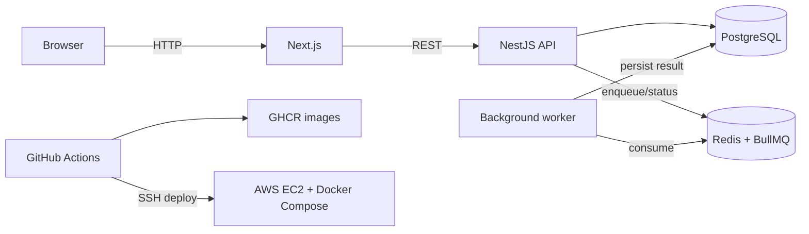

# Full-Stack DevOps Assessment

Next.js frontend + NestJS REST API + PostgreSQL + Redis/BullMQ worker. This implementation includes separate multi-stage Dockerfiles, Compose health checks and persistent volumes, a GitHub Actions pipeline, GHCR image publishing, and an SSH deployment flow for AWS EC2.

## Architecture

For this assessment, a single EC2 instance runs the Compose stack to keep the demonstration straightforward. For production, use RDS PostgreSQL, ElastiCache Redis, ALB with TLS, Secrets Manager/SSM, backups, monitoring and least-privilege IAM.

## Run locally

1. Install Docker Engine and Docker Compose v2.
2. Copy `.env.example` to `.env`, then change the password.
3. Run `docker compose up --build -d`.
4. Open http://localhost:3000 and submit a job. The UI polls the API until the BullMQ worker completes it.
5. API health: http://localhost:4000/health.
6. Inspect logs: `docker compose logs -f api worker`.

`docker compose down` stops services and retains the PostgreSQL volume. `docker compose down -v` deletes persisted data; use only for a deliberate reset.

## Job workflow

Browser POSTs `/jobs`; NestJS inserts a `queued` record and enqueues a BullMQ job in Redis. The separate worker marks it `processing`, simulates work, then persists `completed` and the result in PostgreSQL. The browser polls GET `/jobs/:id`.

## CI/CD setup

Create GitHub repository secrets:
- `EC2_HOST`, `EC2_USER`, `EC2_SSH_PRIVATE_KEY`
- `EC2_APP_DIR` (e.g. `/opt/fullstack-devops-assessment`)
- `APP_ENV_FILE` (full production `.env` contents)

Create repository variable `NEXT_PUBLIC_API_URL` with the public API URL. It is embedded at frontend build time.

The workflow runs checks on pull requests. On pushes to `main`, it validates, builds and pushes three GHCR images tagged with the commit SHA and `latest`, then deploys the immutable SHA tag to EC2. Failed validation prevents publishing/deployment.

Prepare an Ubuntu EC2 instance with Docker Engine + Compose plugin, SSH access for the deploy user, and a security group allowing SSH from your IP plus HTTP traffic required for the demo. Run `deploy/ec2-user-data.sh` as user data or install Docker manually. Create the app directory and ensure the deploy user can use Docker.

## Rollback and reliability

- Compose `restart: unless-stopped`; health checks for PostgreSQL, Redis, API and frontend.
- PostgreSQL data in named `postgres_data` volume. A volume is persistence, not a backup; schedule backups.
- Roll back by deploying a previously successful immutable SHA image: `IMAGE_TAG=<previous-sha> GHCR_OWNER=<owner> docker compose up -d`.
- Troubleshoot with `docker compose ps`, `docker compose logs --tail=200 api`, `docker inspect <container>`, and `docker exec -it <container> sh`.
- `/health` provides an API liveness check; add CloudWatch, alarms, centralized logs and uptime monitoring for production.
- TypeORM schema synchronization is enabled for this demo only. Replace with reviewed migrations before production.

## Security

Never commit `.env`. GitHub Actions uses GitHub Secrets and the ephemeral `GITHUB_TOKEN` for GHCR. Restrict SSH ingress, do not expose database/Redis ports, use encrypted disks, rotate credentials, and move production secrets to AWS Secrets Manager or SSM Parameter Store. Prefer a reverse proxy and TLS rather than directly exposing service ports.

## Walkthrough video (strictly under 180 seconds)

- 0:00–0:30 architecture and EC2/Compose.
- 0:30–1:00 Dockerfiles and Compose health checks/volume.
- 1:00–1:40 successful Actions run and SHA-tagged GHCR images.
- 1:40–2:20 deployed UI; submit a task and show completed status/result.
- 2:20–2:50 secrets, persistent volume, restart policy and rollback.

**Important:** This ZIP is source code and deployment automation, not a live deployment. You must configure AWS/GitHub credentials, run the workflow, verify your public endpoint, and record your own screen. Do not invent a deployment URL or video.
